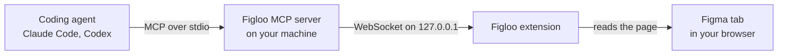

<p align="center">
  
</p>

<h1 align="center">Figloo</h1>

<p align="center">
  <strong>Let your coding agent read the Figma design you have open, with view access.</strong><br>
  A Chrome extension and a local MCP server for Claude Code and Codex. No Figma API token, no Dev seat, no monthly quota.
</p>

<p align="center">
  <a href="https://github.com/g761007/figloo/actions/workflows/ci.yml"></a>
  <a href="https://github.com/g761007/figloo/actions/workflows/figma-canary.yml"></a>
  <a href="https://github.com/g761007/figloo/releases/latest"></a>
  <a href="LICENSE"></a>
</p>

<p align="center">English | <a href="README.zh-TW.md">繁體中文</a></p>

Select a screen in Figma, paste one line into your coding agent, and it builds the page from the real design: the exact spacing, colors, and text styles, your project's own tokens and components, and the icons exported into your repository. Figloo reads what Figma's web UI shows in your browser tab, so view access to the file is all you need. It may move the view and the selection while it reads, and puts them back, but it never edits the design.

## Why Figloo

- **View access is enough.** Figma's REST API and its official MCP server set their limits by seat: a View or Collab seat gets up to 6 calls a month ([REST API](https://developers.figma.com/docs/rest-api/rate-limits), [MCP server](https://developers.figma.com/docs/figma-mcp-server/rate-limits-access/), as of October 2026). Figloo reads the tab you already have open, so it needs no token or paid seat, and it has no monthly quota.
- **Exact values, not guesses from a screenshot.** Sizes and sizing modes, auto layout, padding, gaps, corner radii, colors, borders, shadows, text styles, component properties, and the Figma variables behind them, exactly as Figma's inspection panel shows them.
- **It speaks your codebase.** `map_tokens` puts every color, text style, spacing value, and radius of a design next to the tokens and components your project already has, for web, iOS, Android, and Flutter projects.
- **Built for whole screens.** A snapshot reads a screen of up to 2,000 layers, about 40 seconds for 600, and saves it, so the agent looks values up, summarizes them, and compares versions without touching Figma again.
- **It starts from what you point at.** The agent begins at the layers you selected, and every call reads a bounded part of the file instead of scanning all of it.
- **Local.** There is no Figloo server or account, and the bridge listens only on `127.0.0.1`. See [Privacy and security](#privacy-and-security).

If your team has Dev or Full seats, Figma's own MCP server reads the file directly and is the more direct route. Figloo is for engineers with view access who want their coding agent to work from the design in front of them.

## How it works



The agent calls Figloo's tools over MCP. The server, which the agent starts, passes each call to the extension, whose content script reads the Figma tab's layers panel and inspection panel, selecting and expanding layers the way you would, and puts your selection and view back afterwards. It uses no Figma REST API, official Figma MCP, Figma plugin, or private internal state.

## Quickstart

Paste this into your coding agent, Claude Code or Codex:

```text
Install Figloo for me by following https://raw.githubusercontent.com/g761007/figloo/main/docs/agent-install.md
```

The agent checks Node.js, downloads the latest release and verifies its checksums, registers the MCP server (as a plugin in Claude Code), and gives you a pairing token. It then walks you through the three steps only you can do:

1. Load the extension: on `chrome://extensions` (or `arc://extensions`), turn on Developer mode, click "Load unpacked", and pick the folder the agent names.
2. Paste the token and port into the extension's options page.
3. In Figma, use the English UI and turn on "Adapt content for screen readers".

Then start a new agent session, open a Figma design file, and ask the agent to call `get_status`. [docs/installation.md](docs/installation.md) describes the same steps by hand.

## What a session looks like

1. In Figma, select the screen you want to build, click the Figloo icon in the toolbar, and click **Copy prompt for the agent**.
2. Paste it into your coding agent and say what you need, for example "Build this screen with our components."
3. Guided by the [figloo-implement skill](#the-figloo-implement-skill), the agent:
   - checks the connection with `get_status`,
   - takes a snapshot of the screen with `snapshot_layer`,
   - maps its values onto your tokens and components with `map_tokens`, and asks you about the near and missing ones,
   - exports the icons and images it needs with `export_assets`,
   - builds the page, compares it with the screenshot, and reports what it used.

## Requirements

- A coding agent that uses MCP servers: Claude Code is verified; Codex has its own install steps, not yet verified end to end
- Node.js 24 to run the MCP server (see `.node-version`)
- A Chromium browser that loads unpacked extensions: Arc and Google Chrome are verified on macOS; other Chromium browsers are expected to work
- A Figma account with at least view access to the file, using Figma's English UI
- pnpm 10, only to build from source (see `packageManager` in `package.json`)

## Install

The [Quickstart](#quickstart) has your agent install the latest release. To install by hand, from the release files or from source, see [docs/installation.md](docs/installation.md#install).

## Set up

Setting up takes four steps: load the extension, register the MCP server with your agent (in Claude Code, the plugin also installs the [figloo-implement skill](#the-figloo-implement-skill)), pair once, and prepare Figma. [docs/installation.md](docs/installation.md#set-up) walks through them and explains the permissions the extension asks for.

## Tools

| Tool | What it does |
|---|---|
| **Find your way** | |
| `get_status` | Whether the extension is connected, and every open Figma tab with its readiness, access, and limitations, with a `hint` when something needs attention. |
| `list_pages`, `explore_page` | The file's pages, and the layers directly on one. |
| `get_anchor` | The layers you selected, as the starting point. |
| `get_neighbors` | A layer's parent, ancestors, siblings, or children, a page at a time. |
| `get_visual_neighbors` | A layer's siblings by where they sit on screen, with the gaps between them. |
| **Read the design** | |
| `inspect_nodes` | Everything the inspection panel shows for up to 5 layers, including the Figma variables values are bound to. |
| `capture` | A screenshot of a layer or the whole page. |
| **Work from snapshots** | |
| `snapshot_layer` | Reads a screen of up to 2,000 layers with a screenshot, saves it, and says what changed since the last snapshot of it. |
| `query_snapshot` | Looks layers up in a snapshot by ref, text, type, or section, without the Figma tab. |
| `summarize_snapshot` | The colors, text styles, spacing, radii, shadows, and components a snapshot uses. |
| `map_tokens` | Puts those values next to your project's tokens and components: exact, near with what differs, or missing. |
| **Export** | |
| `export_asset`, `export_assets` | Exports layers as SVG, PNG, JPG, or PDF at the scales you need, into your project. |
| `release_context` | Forgets a context and its layer refs. |

Every parameter, result field, and error code is in [docs/mcp-tools.md](docs/mcp-tools.md).

Good to know:

- Figma applies selection, zoom, and page changes only while its tab is visible, so keep the Figma tab beside your agent window. Reading pages and the selection works from a background tab; the tools that need the tab on screen say so with `TAB_IN_BACKGROUND`, and a snapshot pauses until the tab is back.
- The tools select layers one after another, and `capture` and `snapshot_layer` zoom the view. Your selection is put back afterwards, and so are the zoom and the place on the canvas when "Adapt content for screen readers" is on.
- With several Figma tabs open, the prompt from the popup names its tab; without it, `get_status` asks the agent to check with you which file to use.

## Toolbar icon and popup

The icon shows, for the tab you are looking at, whether Figloo can use it. Hover over it for the reason and for which coding agent session Figloo serves.

| Icon | Meaning |
|---|---|
| Indigo | A Figma design file Figloo can read. |
| Indigo with an amber `!` | A design file Figloo can read with a limitation, such as a guest session or a minimized UI. |
| Gray | Not a Figma design file, or the file is still loading. |
| Gray with a red `!` | A Figma design page Figloo cannot read. |

The popup shows the file, the page, whether Figloo is ready, and the selected layer's path and children.

- **Copy prompt for the agent** copies text to paste into your coding agent: it names the file, the tab, and the selected layer, and tells the agent which tools to start with. For a selected screen, it asks for a snapshot first. The popup shows the prompt before you copy it.
- **Diagnostics** shows a short report for a [bug report](https://github.com/g761007/figloo/issues/new?template=bug_report.yml): versions, browser, connection, readiness, and the latest error codes, with no file, page, or layer names and no links.

## The figloo-implement skill

[`plugins/figloo/skills/figloo-implement/`](plugins/figloo/skills/figloo-implement/SKILL.md) guides an agent through implementing a Figma page or component with Figloo: check the connection, settle what to build, take a snapshot, map the design onto the project's tokens and components, read the details section by section, build, compare the result with the screenshot, and report. It also covers looking at a design and exporting assets. The agent picks it up when you paste a prompt from the popup or ask to build or export from the design you have open.

The Claude Code plugin includes it. To use it without the plugin, copy or link the folder:

| Agent | Where the folder goes | How to call it by name |
|---|---|---|
| Claude Code | `~/.claude/skills/figloo-implement` | `/figloo-implement` |
| Codex | `~/.agents/skills/figloo-implement` | `$figloo-implement` |

Codex also needs the MCP server registered in `~/.codex/config.toml`, as shown in [Register the MCP server](docs/installation.md#2-register-the-mcp-server-with-your-agent).

## Troubleshooting

Start with `get_status`: ask the agent to call it, and its `hint` says what to fix, while each tab lists the limitations it has and what to do about them. Outside an agent session, `figloo-mcp doctor` checks Node.js, the config file, and who holds the port. [docs/troubleshooting.md](docs/troubleshooting.md) lists where else to look and the common problems, from `DISCONNECTED` to `BUSY`.

## Privacy and security

Figloo runs on your machine. The MCP server listens only on `127.0.0.1` and accepts only the Figloo extension, identified by its pinned ID and the pairing token. Figloo has no server or account of its own, and it hands design content only to the agent that called the tool; what the agent does with it, such as sending it to its model provider, is up to the agent. Snapshots stay in `~/.figloo/snapshots/`. [SECURITY.md](SECURITY.md) has the details and how to report a vulnerability.

## Status and roadmap

Figloo is developed and tested against real Figma pages: every release passes its test suite and an end-to-end test in a real browser, and a canary runs against Figma every day to catch changes in its web UI early. Its version is still 0.x, so tools and results may change between minor versions.

- [CHANGELOG.md](CHANGELOG.md): what each release changed.
- [ROADMAP.md](ROADMAP.md): what comes next, from other Figma UI languages to more browsers and distribution.
- [docs/compatibility/](docs/compatibility/README.md): supported browsers and Figma settings, known limitations, and what was verified on real Figma pages.

## Contributing

Bug reports and pull requests are welcome.

- **Found a bug?** Open a [bug report](https://github.com/g761007/figloo/issues/new?template=bug_report.yml) and paste the Diagnostics from the popup.
- **Want to change the code?** [docs/development.md](docs/development.md) covers building, the test suites, and how releases are made. Figma's web UI changes without notice, so changes to how Figloo reads it come with a captured fixture and a test.
- **Found a security issue?** Report it privately as described in [SECURITY.md](SECURITY.md).

## License

Figloo is released under the [MIT License](LICENSE).
