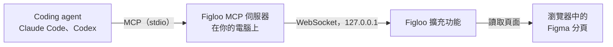

<p align="center">
  
</p>

<h1 align="center">Figloo</h1>

<p align="center">
  <strong>讓 coding agent 讀取你開著的 Figma 設計稿，有檢視權限就夠了。</strong><br>
  給 Claude Code 與 Codex 用的 Chrome 擴充功能加本機 MCP 伺服器。不需要 Figma API token、不需要 Dev 席位，也沒有每月額度。
</p>

<p align="center">
  <a href="https://github.com/g761007/figloo/actions/workflows/ci.yml"></a>
  <a href="https://github.com/g761007/figloo/actions/workflows/figma-canary.yml"></a>
  <a href="https://github.com/g761007/figloo/releases/latest"></a>
  <a href="LICENSE"></a>
</p>

<p align="center"><a href="README.md">English</a> | 繁體中文</p>

> 本文件譯自英文版 [README.md](README.md)，兩者不一致時以英文版為準。

在 Figma 選取一個畫面，貼一句話給你的 coding agent，它就會依照真正的設計稿實作頁面：精確的間距、顏色與文字樣式，用的是專案自己的 token 與元件，icon 也會匯出到你的 repo。Figloo 讀取的是瀏覽器分頁中 Figma 網頁介面顯示的內容，所以對檔案有檢視權限就夠了。讀取時它可能會移動畫面與選取，結束後會還原，但絕不編輯設計稿。

## 為什麼用 Figloo

- **有檢視權限就夠了。** Figma 的 REST API 與官方 MCP 伺服器依席位設定額度：View 或 Collab 席位每月最多 6 次呼叫（見 [REST API](https://developers.figma.com/docs/rest-api/rate-limits) 與 [MCP 伺服器](https://developers.figma.com/docs/figma-mcp-server/rate-limits-access/) 的說明，以 2026 年 10 月為準）。Figloo 讀取你已經開著的分頁，不需要 token 或付費席位，也沒有每月額度。
- **精確的數值，不是從截圖猜的。** 尺寸與尺寸模式、auto layout、padding、gap、圓角、顏色、邊框、陰影、文字樣式、元件屬性，以及背後綁定的 Figma 變數，都與 Figma 屬性面板顯示的完全相同。
- **對得上你的程式碼。** `map_tokens` 把設計稿的每個顏色、文字樣式、間距與圓角，對照專案既有的 token 與元件，支援 Web、iOS、Android 與 Flutter 專案。
- **為整個畫面設計。** 快照一次讀取最多 2,000 個圖層的畫面，600 個圖層約 40 秒，並存起來；之後 agent 查詢數值、摘要與比對版本，都不必再操作 Figma。
- **從你指的地方開始。** Agent 從你選取的圖層出發，每次呼叫只讀取檔案中有上限的一部分，不掃描整份檔案。
- **在本機執行。** 沒有 Figloo 伺服器或帳號，bridge 只監聽 `127.0.0.1`。見[隱私與安全](#隱私與安全)。

如果團隊有 Dev 或 Full 席位，Figma 官方的 MCP 伺服器直接讀取檔案，是更直接的做法。Figloo 適合只有檢視權限、想讓 coding agent 依眼前設計稿工作的工程師。

## 運作方式



Agent 透過 MCP 呼叫 Figloo 的工具。由 agent 啟動的伺服器把每次呼叫交給擴充功能，擴充功能的 content script 讀取 Figma 分頁的圖層面板與屬性面板，像你一樣選取與展開圖層，結束後還原你的選取與畫面。它不使用 Figma REST API、官方 Figma MCP、Figma plugin 或私有的內部狀態。

## 快速開始

把這句話貼給你的 coding agent，Claude Code 或 Codex 都可以：

```text
Install Figloo for me by following https://raw.githubusercontent.com/g761007/figloo/main/docs/agent-install.md
```

Agent 會檢查 Node.js、下載最新版本並核對檢查碼、註冊 MCP 伺服器（Claude Code 會安裝 plugin），再給你配對 token。接著它會引導你完成三件只能由你做的事：

1. 載入擴充功能：在 `chrome://extensions`（或 `arc://extensions`）開啟開發人員模式，按「載入未封裝項目」，選擇 agent 告訴你的資料夾。
2. 在擴充功能的選項頁面貼上 token 與連接埠。
3. 在 Figma 中使用英文介面，並開啟「Adapt content for screen readers」。

最後開一個新的 agent 工作階段，打開 Figma 設計檔，請 agent 呼叫 `get_status`。[docs/installation.zh-TW.md](docs/installation.zh-TW.md) 是同樣步驟的手動版本。

## 實際使用的樣子

1. 在 Figma 選取要實作的畫面，點工具列上的 Figloo 圖示，再按「**Copy prompt for the agent**」。
2. 貼到 coding agent，說明你要做什麼，例如「用我們的元件實作這個畫面」。
3. Agent 在 [figloo-implement skill](#figloo-implement-skill) 的引導下：
   - 用 `get_status` 確認連線；
   - 用 `snapshot_layer` 為畫面建立快照；
   - 用 `map_tokens` 把數值對應到你的 token 與元件，相近與沒對到的會先問你；
   - 用 `export_assets` 匯出需要的 icon 與圖片；
   - 實作頁面、與截圖比對，並回報用了哪些 token 與元件。

## 需求

- 支援 MCP 伺服器的 coding agent：Claude Code 已驗證；Codex 有專屬的安裝步驟，但尚未完整實測
- Node.js 24，用來執行 MCP 伺服器（見 `.node-version`）
- 能載入未封裝擴充功能的 Chromium 系瀏覽器：Arc 與 Google Chrome 已在 macOS 上驗證，其他 Chromium 瀏覽器預期可用
- 對檔案至少有檢視權限的 Figma 帳號，並使用 Figma 的英文介面
- pnpm 10，只有從原始碼建置時需要（見 `package.json` 的 `packageManager`）

## 安裝

[快速開始](#快速開始)會請 agent 安裝最新版本。要手動安裝，無論使用 release 檔案或從原始碼，見 [docs/installation.zh-TW.md](docs/installation.zh-TW.md#安裝)。

## 設定

設定分四個步驟：載入擴充功能、在 agent 中註冊 MCP 伺服器（Claude Code 的 plugin 會一併安裝 [figloo-implement skill](#figloo-implement-skill)）、配對一次，以及準備 Figma。[docs/installation.zh-TW.md](docs/installation.zh-TW.md#設定) 逐步說明，也解釋擴充功能要求的權限。

## 工具

| 工具 | 做什麼 |
|---|---|
| **找到位置** | |
| `get_status` | 擴充功能是否已連線，以及每個開著的 Figma 分頁的就緒狀態、權限與限制；需要處理時附上 `hint`。 |
| `list_pages`、`explore_page` | 檔案的頁面，以及某一頁上直接的圖層。 |
| `get_anchor` | 你選取的圖層，作為起點。 |
| `get_neighbors` | 圖層的父層、祖先、同層或子層，每次一段。 |
| `get_visual_neighbors` | 依畫面位置排列的同層圖層，附上彼此的間距。 |
| **讀取設計稿** | |
| `inspect_nodes` | 最多 5 個圖層在屬性面板中顯示的一切，包括數值綁定的 Figma 變數。 |
| `capture` | 圖層或整個頁面的截圖。 |
| **依快照工作** | |
| `snapshot_layer` | 讀取最多 2,000 個圖層的畫面並附截圖，存成快照，並說明和上一份快照相比改了什麼。 |
| `query_snapshot` | 不需要 Figma 分頁，依 ref、文字、類型或區塊查詢快照中的圖層。 |
| `summarize_snapshot` | 快照用到的顏色、文字樣式、間距、圓角、陰影與元件。 |
| `map_tokens` | 把這些數值對照專案的 token 與元件：完全相同、相近（附上差在哪裡），或沒有。 |
| **匯出** | |
| `export_asset`、`export_assets` | 依需要的比例，把圖層匯出成 SVG、PNG、JPG 或 PDF，存進專案。 |
| `release_context` | 釋放一個 context 與它的圖層 ref。 |

每個參數、回傳欄位與錯誤碼，見 [docs/mcp-tools.md](docs/mcp-tools.md)（英文）。

使用時要知道的事：

- Figma 只在分頁可見時套用選取、縮放與切換頁面，所以請把 Figma 分頁放在 agent 視窗旁邊。讀取頁面與選取在背景分頁也能運作；需要分頁在畫面上的工具會回報 `TAB_IN_BACKGROUND`，快照則會暫停，等分頁回到畫面上再繼續。
- 這些工具會依序選取圖層，`capture` 與 `snapshot_layer` 還會縮放畫面。之後會還原你的選取；開啟「Adapt content for screen readers」時，縮放比例與畫面位置也會還原。
- 開著多個 Figma 分頁時，從 popup 複製的提示會寫出分頁；沒有提示時，`get_status` 會請 agent 向你確認要用哪個檔案。

## 工具列圖示與 popup

圖示會針對你正在看的分頁，顯示 Figloo 能不能使用它。滑鼠移到圖示上，會顯示原因，以及 Figloo 正在服務哪個 coding agent 工作階段。

| 圖示 | 意思 |
|---|---|
| 靛藍色 | Figloo 可以讀取的 Figma 設計檔。 |
| 靛藍色加上琥珀色 `!` | Figloo 可以讀取，但有限制，例如訪客工作階段或介面縮到最小。 |
| 灰色 | 不是 Figma 設計檔，或檔案還在載入。 |
| 灰色加上紅色 `!` | Figloo 無法讀取的 Figma 設計頁面。 |

Popup 會顯示檔案、頁面、Figloo 是否就緒，以及選取圖層的路徑與子層。

- **Copy prompt for the agent** 會複製一段要貼給 coding agent 的文字：寫出檔案、分頁與選取的圖層，並告訴 agent 先用哪些工具。選取的是一個畫面時，會請 agent 先建立快照。複製之前，popup 會先顯示內容。
- **Diagnostics** 會顯示一段可以貼到 [bug report](https://github.com/g761007/figloo/issues/new?template=bug_report.yml) 的簡短報告：版本、瀏覽器、連線、就緒狀態與最近的錯誤碼；沒有檔案、頁面或圖層的名稱，也沒有連結。

## figloo-implement skill

[`plugins/figloo/skills/figloo-implement/`](plugins/figloo/skills/figloo-implement/SKILL.md) 引導 agent 用 Figloo 實作 Figma 的頁面或元件：確認連線、確認要實作的範圍、建立快照、把設計稿對應到專案既有的 token 與元件、依區塊讀取細節、實作、與截圖比對，最後回報。它也涵蓋查看設計稿與匯出圖檔。貼上 popup 複製的提示，或要求依照開著的設計稿實作或切圖時，agent 會自動使用它。

Claude Code plugin 已經包含這個 skill。不使用 plugin 時，複製或連結這個資料夾：

| Agent | 資料夾放在 | 以名稱呼叫 |
|---|---|---|
| Claude Code | `~/.claude/skills/figloo-implement` | `/figloo-implement` |
| Codex | `~/.agents/skills/figloo-implement` | `$figloo-implement` |

Codex 另外需要在 `~/.codex/config.toml` 註冊 MCP 伺服器，見[在 agent 中註冊 MCP 伺服器](docs/installation.zh-TW.md#2-在-agent-中註冊-mcp-伺服器)。

## 疑難排解

先從 `get_status` 開始：請 agent 呼叫它，它的 `hint` 會說明要修正什麼，每個分頁也會列出它的限制與處理方式。不在 agent 工作階段中時，`figloo-mcp doctor` 會檢查 Node.js、設定檔，以及連接埠由誰持有。其他可以查看的地方，以及從 `DISCONNECTED` 到 `BUSY` 的常見問題，見 [docs/troubleshooting.zh-TW.md](docs/troubleshooting.zh-TW.md)。

## 隱私與安全

Figloo 在你的電腦上執行。MCP 伺服器只監聽 `127.0.0.1`，而且只接受 Figloo 擴充功能的連線，以固定的擴充功能 ID 與配對 token 識別。Figloo 沒有自己的伺服器或帳號，設計內容只交給呼叫工具的 agent；agent 如何處理這些內容，例如送到它使用的模型服務，由 agent 決定。快照存在 `~/.figloo/snapshots/`。細節與回報漏洞的方式見 [SECURITY.md](SECURITY.md)（英文）。

## 狀態與 Roadmap

Figloo 以真實的 Figma 頁面持續開發與測試：每次發版都要通過測試套件與真實瀏覽器中的端對端測試，每天也有 canary 對 Figma 執行，及早發現網頁介面的變動。版本仍是 0.x，工具與回傳結果在 minor 版本之間可能改變。

- [CHANGELOG.md](CHANGELOG.md)（英文）：各版本的變更。
- [ROADMAP.md](ROADMAP.md)（英文）：接下來的方向，從其他 Figma 介面語言到更多瀏覽器與發佈管道。
- [docs/compatibility/](docs/compatibility/README.md)：支援的瀏覽器與 Figma 設定、已知限制，以及在真實 Figma 頁面上驗證過的項目。

## 參與貢獻

歡迎回報問題與發 pull request。

- **遇到 bug？** 開一個 [bug report](https://github.com/g761007/figloo/issues/new?template=bug_report.yml)，貼上 popup 中的 Diagnostics。
- **想改程式？** [docs/development.zh-TW.md](docs/development.zh-TW.md) 說明建置、各種測試與發版的方式。Figma 的網頁介面會無預警改變，所以改動 Figloo 讀取介面的方式時，請附上擷取的 fixture 與測試。
- **發現安全問題？** 請依 [SECURITY.md](SECURITY.md)（英文）的說明私下回報。

## 授權

Figloo 以 [MIT License](LICENSE) 授權。
